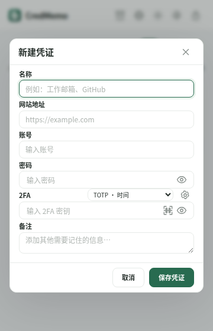

# CredMemo

CredMemo 是一个本地加密管理账号、密码和 2FA 验证码的 Chrome 插件。凭证保存在当前浏览器中，无需注册，支持离线查看和生成验证码。

## 功能

- **凭证管理**：单独保存账号密码、单独保存 2FA，或将账号密码与对应 2FA 一起保存；支持网站地址、备注、多组账号和验证码。
- **验证码生成**：支持 TOTP、HOTP、Steam、Battle.net、TOTP HEX 和 HOTP HEX，保存密钥后即可使用。
- **二维码识别**：在当前网页框选二维码，直接创建 2FA 凭证，或回填正在编辑的表单。
- **二维码生成**：将已保存的 2FA 显示为绑定二维码，供其他验证器扫码添加。
- **复制与填充**：一键复制账号、密码和验证码，在匹配的网站填充账号密码。
- **搜索与排序**：点击搜索图标，按名称、账号、网站或 2FA 标签搜索，拖拽调整顺序。
- **备份与恢复**：加密备份、恢复备份、JSON 导入导出及复制导出。
- **本地加密**：主密码保护、闲置自动锁定，普通窗口与已授权的无痕窗口共用凭证库。
- **语言与主题**：中文、English；浅色、深色及跟随系统主题。

## 安装与更新

### ZIP 安装

1. 在 [Releases](https://github.com/AcidEcho/CredMemo/releases/latest) 下载 `CredMemo-<版本>.zip`。
2. 解压后将 `CredMemo` 文件夹保留在固定位置，确保其中直接包含 `manifest.json`。
3. 打开 `chrome://extensions/`，开启“开发者模式”。
4. 点击“加载已解压的扩展程序”，选择 `CredMemo` 文件夹。
5. 从 Chrome 扩展菜单打开插件，创建 **6～12 位主密码**。

插件没有默认账号和密码。可通过扩展菜单中的图钉固定或取消固定到工具栏。

### 覆盖更新

1. 先导出加密备份，再关闭插件弹窗。
2. 将新版 ZIP 中 `CredMemo/` 里面的文件覆盖到原安装目录，保持 `manifest.json` 的路径不变。
3. 在 `chrome://extensions/` 找到原插件，点击“重新加载”。

继续使用同一浏览器配置和原目录即可保留插件身份与本地凭证。不要先卸载，也不要另建目录重复加载；卸载会删除本地凭证，不同加载目录会产生独立的凭证库。

### CRX 安装

Releases 同时提供固定签名的 `.crx` 安装包。Chrome 可能限制商店外 CRX 安装；无法启用时，请使用 ZIP 方式。

从 ZIP 切换到 CRX 时，需要先导出加密备份，再在新安装中恢复，凭证不会自动迁移。

## 使用

快捷键 **Alt+Shift+C** 打开插件，可在 `chrome://extensions/shortcuts` 调整。

### 创建与编辑凭证

点击列表上方的加号，填写名称、网站地址、账号、密码、2FA 和备注。名称必填，其余按需填写，至少保存一组有效账号密码或 2FA。卡片旁可直接编辑、确认删除，点击卡片标题可查看详情。

2FA 输入框只接受密钥；HEX 类型填写十六进制密钥，其他类型填写 Base32 密钥。默认参数为 TOTP、6 位、30 秒、SHA1，输入框旁可选择验证码类型和调整参数。

支持 SHA1、SHA256、SHA512、GOST 34.11-2012-256 / 512。普通数字验证码支持 1～10 位和正整数秒周期；Steam 使用 5 位字符，Battle.net 使用 8 位数字。HOTP / HOTP HEX 仅在点击“下一计数验证码”时递增计数，查看、复制和重启不会消耗计数。

### 扫码添加 2FA

| 入口 | 识别后的操作 |
| --- | --- |
| 列表上方的扫码图标 | 自动创建仅含 2FA 的凭证 |
| 新建或编辑表单中的扫码图标 | 回填密钥和参数，保留已填内容，点击保存后写入 |

点击扫码后，在当前网页拖动框选完整二维码。识别失败可重新框选，按 Esc 或点击“取消”退出；表单内取消扫码会恢复未保存的内容。

仅支持当前网页的可见区域，不截取桌面或其他应用。浏览器内部页面和部分受保护页面无法扫码；截图仅在本地临时处理，不保存。

### 显示绑定二维码

点击动态码旁的二维码图标，即可用其他验证器扫码添加相同的 2FA。二维码保留密钥及对应参数，不会更改网站端的绑定状态；网站更换密钥后，需更新保存的密钥。

二维码在本地生成，不上传，关闭对话框或锁定后移除。

### 网站填充、搜索与排序

在凭证中填写网站地址，然后在对应网页打开插件进行填充。填充要求协议、域名和端口一致；存在多个登录表单时，先点击目标表单中的输入框。插件不会自动提交登录表单。

列表默认显示全部凭证。点击与新建、扫码并排的搜索图标展开输入框，支持名称、账号、网站和 2FA 标签搜索；按 Esc 或点击关闭按钮可清空搜索并收起。也可按 `/` 快速打开搜索。

拖动卡片左侧的手柄排序，也可聚焦手柄后使用上下方向键。搜索时只调整可见凭证，隐藏项的位置不变。排序会保存在本地，编辑不改变顺序，新凭证显示在顶部。

### 备份与恢复

通过工具栏的备份入口操作：

| 操作 | 说明 |
| --- | --- |
| 加密备份 | 设置独立的 12～256 位备份密码，下载 `.credmemo` 文件 |
| 恢复备份 | 选择文件并输入备份密码，追加导入凭证 |
| 导出 / 复制导出 | 验证主密码后导出包含明文凭证的 JSON |
| 导入 JSON | 导入 CredMemo JSON，校验通过后追加保存 |

导入和恢复不会覆盖原凭证，也不会自动去重。主密码无法找回，请妥善保存加密备份及其密码。

### 无痕窗口

在 `chrome://extensions/` → CredMemo →“详情”中开启“在无痕模式下启用”，按浏览器提示重新加载。首次需要手动授权，之后由 Chrome 保留设置。

普通与无痕窗口共用凭证库及解锁、锁定状态。无痕窗口中保存的凭证也会保留在本地，关闭无痕窗口不会删除。

## 隐私与安全

凭证使用 AES-256-GCM 加密保存在当前浏览器中，闲置 15 分钟或重启浏览器后需要重新解锁。扫码识别、绑定二维码和验证码生成均在本地完成，不上传凭证，不使用 Chrome 同步。

卸载插件、删除扩展数据或更换浏览器配置前，请先备份凭证。

## 界面预览

| 凭证列表 | 新建凭证 | 2FA 绑定二维码 |
| --- | --- | --- |
|  |  |  |

## 许可证

采用 [Apache License 2.0](LICENSE)。分发时须附带许可证，保留适用的版权、署名及 [NOTICE](NOTICE) 声明，并注明对文件所作的修改。适用的第三方许可证随安装包提供，具体要求以各许可证正文为准。
