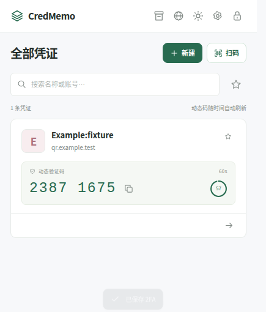

# CredMemo

[](https://github.com/AcidEcho/CredMemo/releases/latest)
[](LICENSE)
[](https://github.com/AcidEcho/CredMemo/actions/workflows/release.yml)

CredMemo 是一个本地加密保存账号、密码和 2FA 动态验证码的 Chrome 扩展。所有凭证保存在当前浏览器中，支持离线使用，无需部署服务端或数据库。

## 功能

- 默认同屏填写名称、网站地址、账号、密码、2FA 和备注，按已填内容保存；支持单独保存账号密码、单独保存 2FA，或组合保存。
- 保存后自动生成动态验证码；导入的多组账号、2FA 可查看和编辑。
- 手动输入 Base32 或对应 HEX 类型的密钥，或点击 2FA 输入框旁的扫码按钮，从当前网页框选二维码并回填原表单。
- 点击标题旁的扫码图标，直接在当前网页上拖动框选二维码，识别后自动保存；无需来源选择或独立扫码窗口。
- 已保存的 2FA 可显示绑定二维码，在其他验证器中重新扫码绑定，保留算法、位数和周期；二维码全程在本地生成。
- 一键复制账号、密码和验证码；支持当前网站的账号密码填充。
- 搜索、当前网站智能筛选、拖拽排序；中文 / English、浅色 / 深色 / 跟随系统主题。
- 加密备份与恢复、JSON 导入导出、复制导出内容。
- 紧凑凭证卡片支持直接编辑、确认删除和查看详情；日常管理操作均在工具栏弹窗内完成。

支持与 Authenticator v8.0.2 对应的六种类型：TOTP、HOTP、Steam、Battle.net，以及十六进制密钥的 TOTP / HOTP。支持 SHA1、SHA256、SHA512、GOST 34.11-2012-256 / 512；普通数字验证码支持 1～10 位及正整数秒周期，Steam 输出 5 位字符，Battle.net 输出 8 位数字。

## 安装

1. 前往 [Releases](https://github.com/AcidEcho/CredMemo/releases/latest)，下载 `CredMemo-<版本>.zip`。
2. ZIP 内固定使用 `CredMemo/` 目录；解压后保留在固定位置，确保 `CredMemo` 内直接包含 `manifest.json`。
3. 在 Chrome 打开 `chrome://extensions/`，开启右上角“开发者模式”。
4. 点击“加载已解压的扩展程序”，选择里面的 `CredMemo` 目录。安装后可从 Chrome 扩展菜单打开 CredMemo。
5. 首次打开时创建主密码，长度为 6～12 个字符。本地插件没有默认账号和默认密码。

无需固定到工具栏。固定状态由 Chrome 版本、用户设置或浏览器策略管理；插件没有自行固定或取消固定的接口，无法保证每台浏览器默认关闭。若安装后已固定，在 `chrome://extensions/` → CredMemo →“详情”关闭“固定到工具栏”，或点击扩展菜单中的图钉取消固定，参见 [Chrome 工具栏接口说明](https://developer.chrome.com/docs/extensions/reference/api/action)。

扩展声明的最低 Chrome 版本为 116。当前自动化浏览器验收使用 Linux Chrome；Windows、macOS 尚未进行真机验收。

快捷键：`Alt+Shift+C`。也可以在 `chrome://extensions/shortcuts` 调整。

### ZIP 覆盖更新

1. 更新前先导出加密备份，然后关闭插件弹窗。
2. 下载新版 ZIP，将其中 `CredMemo/` **里面的文件**覆盖原来的扩展目录，确保 `manifest.json` 仍在原路径。不要在原目录内再嵌套一层 `CredMemo`。
3. 在 `chrome://extensions/` 找到已有的 CredMemo，点击“重新加载”，确认版本号已更新，然后解锁原凭证库。

ZIP 文件名保留版本号，例如 `CredMemo-2.10.1.zip`，压缩包内顶层目录始终为 `CredMemo`。若解压工具额外创建版本目录，加载时选择里面的 `CredMemo`。

继续使用同一个浏览器配置和原安装目录，插件身份及本地凭证会保留。不要先卸载旧版，也不要另建目录重复加载；卸载会删除本地凭证。新增权限时，按 Chrome 提示确认。

创建、解锁、导出及修改主密码均使用 6～12 个字符；独立的备份密码使用 12～256 个字符。项目处于开发阶段，不再维护历史数据迁移及旧长主密码兼容。

### 出现两个 CredMemo 时

扩展名称始终是 `CredMemo`；Chrome 在名称旁单独显示版本号。Chrome 按插件 ID 区分安装，不按名称或版本号合并。当前 ZIP 未设置固定公钥，加载不同的解压目录通常会产生不同 ID，因此新建版本目录再点击“加载已解压的扩展程序”会出现两个插件。

更新时，将新版 ZIP 中 `CredMemo/` **里面的文件**覆盖到原来加载的目录，再点击原插件的“重新加载”。即使原目录名包含旧版本号，也保留该目录名。例如原来加载 `D:\Apps\CredMemo-2.5.0\manifest.json`，升级后仍使用这个路径，文件内的版本会更新。不要把新版目录嵌套放进旧目录。

下载 GitHub 安装包不会自动更新浏览器中的插件。若已出现两个插件，先分别备份其中需要保留的凭证，再在保留的那一份上按原目录覆盖更新；不同 ID 的凭证库相互独立，不会自动合并。

### CRX 安装与更新

每次 Release 同时提供 `CredMemo-<版本>.zip` 与固定签名的 `CredMemo-<版本>.crx`。CRX 使用 CRX3 格式，同一签名下的版本保持同一插件身份。直接安装 CRX 取决于系统和浏览器的外部分发策略；若 Chrome 拒绝安装，请使用上述 ZIP 加载方式，参见 [Chrome 外部分发说明](https://developer.chrome.com/docs/extensions/how-to/distribute/install-extensions)。

从 ZIP 加载切换到 CRX 会使用不同的插件身份，需要先导出加密备份，再在 CRX 版本中恢复。已有 ZIP 用户可继续按原目录覆盖更新；不要将切换安装方式视为原凭证自动迁移。Windows、macOS 的 CRX 安装及覆盖更新尚未真机验收。

## 使用

### 新建凭证

顶部“新建、扫码”仅显示图标，保留悬停提示和无障碍名称。弹窗宽度为 360px，页面和对话框标题采用更紧凑字号。

点击标题旁的加号图标，依次填写名称、网站地址、账号、密码、2FA、备注，默认六项和保存按钮同屏可见。基础输入框固定保留，空白凭证项会自动忽略，至少要填写一组有效账号或 2FA。

2FA 输入框旁的扫码按钮会进入当前网页框选；识别后回到原表单，保留已填名称、网站、账号、密码和备注，回填密钥与动态码参数，点击“保存”后才写入凭证库。取消扫码会恢复原表单；名称空白时使用二维码中的名称。

不提供“更多选项”“添加账号”“添加 2FA”“从图片识别”、账号标签输入、随机密码生成及收藏功能。导入数据中的多组账号、2FA 和标签可查看和编辑，额外条目可移除；所有验证码均保存明确的类型及对应参数。

手动输入只接受密钥，不支持粘贴配置链接；保存、JSON 导入和备份恢复使用相同校验。普通 2FA 默认使用 TOTP、6 位、30 秒、SHA1。2FA 标签旁可选择类型，参数按钮可调整算法、位数和周期；HOTP 显示初始计数。HOTP / HOTP HEX 只有点击“下一计数验证码”才递增，查看、复制、锁定或重启不会消耗计数。新建、编辑、扫码回填、二维码展示及备份均保留对应类型和参数。手动密钥不接受配置链接；HEX 类型输入十六进制密钥，其他类型输入 Base32 密钥。

卡片标题旁提供编辑和删除；点击标题查看详情。删除需要再次确认，取消时不会修改凭证。

如需网页填充，请在凭证中配置网站地址，并在对应网站打开插件。填充会核对协议、域名和端口；多个表单存在歧义时，先点击目标表单的输入框。插件不会自动提交登录表单。

### 网站筛选与排序

搜索框旁的筛选按钮默认开启：优先按凭证网站的注册域名匹配；未配置网站时，按名称和 2FA 标签中的服务名辅助匹配。子域名可归入同一网站，公共后缀与独立托管域名按 Public Suffix List 区分。没有匹配项或当前页面不可识别时显示全部；关闭按钮也可查看全部。筛选偏好保存在本地。

网站筛选只影响展示，不放宽填充校验；账号密码填充仍要求协议、域名和端口完全相同。

拖动卡片左侧的排序手柄调整顺序，也可聚焦手柄后使用上下方向键。筛选或搜索时仅调整可见凭证的位置，隐藏凭证的位置保持不变。顺序加密保存在凭证库内，重启后保留；编辑不改变顺序，新凭证放在顶部，备份恢复保留导入批次内的顺序。

### 截图扫码

1. 点击标题旁的扫码图标（悬停显示用途）。
2. 当前网页立即显示框选层，拖动框选完整二维码并松开。
3. 识别成功后自动创建仅含 2FA 的凭证，并尝试重新打开插件列表；若浏览器未自动打开，可从扩展菜单打开 CredMemo 查看。

识别失败时可重新框选；按 Esc 或点击“取消”退出。仅截取当前网页的可见区域，截图在本地临时处理，不保存截图。浏览器内部页面、扩展页面和部分受保护页面无法注入框选层，会显示提示。此入口不截取其他应用或桌面，支持上述验证码类型的绑定二维码；不支持 Google Authenticator 批量迁移二维码。

新建 / 编辑凭证内的扫码只回填当前表单，识别后等待用户保存；顶部列表的扫码图标仍直接创建独立 2FA 凭证。未保存表单仅暂存于浏览器会话内存，锁定或浏览器会话结束即清除，不会写入持久存储或传入网页。

### 显示 2FA 绑定二维码

点击卡片动态码旁的二维码图标，或在详情中选择对应 2FA 的二维码图标，即可使用另一台设备的验证器扫码。二维码包含已有密钥及算法、位数和周期，不会生成新密钥，也不会改变网站端的 2FA 绑定状态。网站重新签发密钥后，仍需更新保存的密钥。

二维码只在当前弹窗内绘制，不上传、不自动下载；关闭对话框或锁定凭证库后移除。只在可信设备上扫码。二维码内部使用标准验证器编码，手动输入框和导入密钥字段不接受配置链接。

### 无痕窗口

在 `chrome://extensions/` → CredMemo →“详情”手动开启“在无痕模式下启用”，按 Chrome 提示重新加载或重启浏览器。首次授权必须由用户操作，插件无法默认打开这个开关，参见 [Chrome 无痕模式说明](https://developer.chrome.com/docs/extensions/develop/security-privacy/user-privacy#saving-data-and-incognito-mode)。授权会由 Chrome 保存，后续无痕窗口可直接打开插件，无需每次重新允许。

采用共享凭证库模式，普通与无痕窗口共用当前浏览器的加密数据及解锁、锁定状态。无痕窗口中主动保存的凭证也会保留在本地，关闭无痕窗口不会删除凭证；浏览器重启仍需解锁。支持无痕中的查看、复制、保存、动态码、网页填充与截图扫码，网页访问仍限用户主动操作时临时授权。

### 备份与恢复

工具栏的备份入口支持：

| 操作 | 行为 |
| --- | --- |
| 加密备份 | 使用独立备份密码，下载 `.credmemo` 文件 |
| 恢复备份 | 选择文件并输入其备份密码，追加导入凭证 |
| 导出 / 复制导出 | 核对主密码后导出 JSON，其中包含明文凭证 |
| 导入 JSON | 导入 CredMemo JSON，校验通过后追加保存 |

导入和恢复采用追加方式，不覆盖原凭证，也不会自动去重。主密码无法找回，请保管好独立密码加密的备份。浏览器配置丢失、卸载扩展或删除扩展数据前，先完成备份。

## 本地存储与权限

凭证通过 AES-256-GCM 加密存入 `chrome.storage.local`，主密码使用 PBKDF2-SHA256 派生密钥，迭代 600,000 次。闲置 15 分钟或重启浏览器后需要重新解锁。数据不会通过 Chrome 同步，也不需要注册或云端账号。

网页截图、二维码解码和动态码生成均在本地执行。扩展页面的内容安全策略禁止网络连接。

| 权限 | 用途 |
| --- | --- |
| `storage` | 保存加密凭证和当前浏览器会话 |
| `activeTab`、`scripting` | 用户操作后，在当前网页执行填充或框选截图 |
| `clipboardWrite` | 复制账号、密码、验证码和导出内容 |
| `alarms` | 闲置后自动锁定 |

## 实际界面

以下截图使用公开测试数据：

| 凭证列表 | 新建凭证 | 2FA 绑定二维码 |
| --- | --- | --- |
|  |  |  |


## 开发

需要 Node.js 24、npm，以及用于生成 ZIP 的 Python 3。

```bash
npm ci
npm run check
npm test
npm run build
npm run package
```

开发时运行 `npm run build` 并加载 `dist/` 目录，无需签名密钥。`npm run package` 同时输出 `release/CredMemo-<版本>.zip` 与 `.crx`；需要通过 `CREDMEMO_CRX_PRIVATE_KEY` 提供签名私钥，或使用本机 `.runtime/crx-signing.pem`。私钥必须与 `crx-public-key.json` 的公开密钥匹配，打包时会校验签名、插件身份以及 CRX 内的 ZIP 内容。下载 ZIP 以 `CredMemo/` 为顶层目录；CRX 使用相同文件的扁平 ZIP 签名，使 `manifest.json` 位于根目录。两者的路径前缀不同，文件内容一致。

```text
extension/          插件界面、加密存储、动态码、填充与扫码
scripts/            构建与打包
tests/extension/    核心测试及浏览器验收
assets/screenshots/ 实际界面截图
.github/workflows/  自动验证和 Release 发布
```

核心测试覆盖 RFC 6238、RFC 4226、RFC 7836 向量、六类验证码、智能筛选与排序、二维码解码、截图页面校验、扫码草稿边界、凭证结构、加密存储、锁定、备份、导入校验和并发版本检查。浏览器验收还覆盖真实工具栏弹窗、六字段表单、剪贴板、填充、主题、当前网页框选、扫码回填和取消恢复、绑定二维码反向解码、无痕窗口操作和权限保留验证；相关脚本位于 `tests/extension/`，运行时需额外安装 Playwright 和对应 Chrome。

`tests/extension/upgrade_acceptance.py` 使用当前构建和当前数据格式，将初始安装版本标识设为测试值，再用当前发行 ZIP 覆盖原目录，验证版本更新、插件 ID、加密数据、列表顺序及浏览器重启后的数据保留。还验证 6 / 12 位主密码、备份恢复及不同加载目录下的独立凭证库，无需下载历史发行包。

### 功能核验范围

按最后确认的纯本地桌面插件需求验收；早期 Python、MySQL、服务端、多用户、手机和平板方案已被后续需求替代。

| 范围 | 本版本行为 |
| --- | --- |
| 凭证与动态码 | 仅账号密码、仅 2FA、组合保存；重开后保留并自动换码 |
| 本地安全 | 加密持久存储、统一 6～12 位主密码、自动及跨窗口锁定 |
| 创建与扫码 | 六字段同屏；网页直接框选；表单扫码回填和取消恢复；列表扫码独立保存 |
| 2FA 再绑定 | 卡片及详情显示本地生成的标准二维码，保留密钥与特殊参数；手动链接输入已移除 |
| 界面 | 图标入口、缩小标题、直接编辑及确认删除；无分类、分组、管理页和收藏 |
| 数据交换与升级 | 加密备份恢复、JSON 导入导出、复制导出、原目录覆盖升级 |
| 无痕 | 手动允许后支持共享凭证库、复制、填充、扫码及锁定；首次默认授权由 Chrome 限制 |
| 固定到工具栏 | 用户在 Chrome 中取消固定；插件无强制修改该设置的接口 |
| 发布 | 每次递增版本并提交，Release 附中文说明、固定目录 ZIP 和固定签名 CRX |

浏览器验收使用 Linux Chrome；Windows、macOS 和第三方验证器真机扫码未实测。二维码已通过真实渲染后的反向解码验证，TOTP、HOTP 和 GOST 分别通过 RFC 6238、RFC 4226、RFC 7836 向量核验。Steam、Battle.net 尚未使用真实游戏账号进行登录验收。

### 发布规则

本项目每次完成修改后递增版本、提交并推送至 `main`，包括仅修改文档的情况。保持 `package.json`、`package-lock.json` 和扩展 `manifest.json` 的版本一致。

每次推送都会触发 [Release 工作流](.github/workflows/release.yml)：安装依赖 → 类型检查 → 核心测试 → 构建打包 → 发布 `v<版本>`、ZIP 和 CRX。签名私钥保存在本仓库的 Actions Secret `CREDMEMO_CRX_PRIVATE_KEY`，不进入源码或发行包。沿用同一私钥才能保持 CRX 身份。已有版本号会导致发布失败，避免覆盖旧版。交付前需确认工作流和两种 Release 资源实际发布成功。

每个版本在 `release-notes/v<版本>.md` 提供中文发布说明，仅保留面向使用者的更新说明。工作流会检查文件非空，并将其正文用于 GitHub Release；缺少说明时停止发布。

此规则仅适用于 CredMemo，详见 [AGENTS.md](AGENTS.md)。

## 许可证与分发声明

本项目采用 [Apache License 2.0](LICENSE)。允许使用、修改和商业分发；分发源码或衍生软件时须遵守许可证中的条件，包括：

- 向接收者提供许可证副本。
- 保留适用的版权、专利、商标和署名声明。
- 在修改过的文件中明确注明已作修改。
- 分发衍生软件时，按许可证第 4(d) 条提供 [NOTICE](NOTICE) 中适用署名声明的可读副本。

NOTICE 包含项目名称、作者与项目地址，发布 ZIP 同时携带 LICENSE、NOTICE 和适用的第三方许可证。以上为简要说明，具体权利与义务以 LICENSE 正文为准。

二维码识别使用 [jsQR](https://github.com/cozmo/jsQR)，同样采用 Apache-2.0，其许可证位于 [extension/public/licenses/jsqr.txt](extension/public/licenses/jsqr.txt)。

构建输出包含 Vite 生成的模块预加载辅助代码，其 MIT 许可证位于 [extension/public/licenses/vite.txt](extension/public/licenses/vite.txt)。

二维码生成使用 [node-qrcode](https://github.com/soldair/node-qrcode) 及 [dijkstrajs](https://github.com/tcort/dijkstrajs)，均为 MIT 许可证；分发包内分别附带 `licenses/qrcode.txt`、`licenses/dijkstrajs.txt`。

验证码的 GOST 实现使用 [@li0ard/gost](https://github.com/li0ard/gost) 和
[@noble/hashes](https://github.com/paulmillr/noble-hashes)，网站域名解析使用
[tldts](https://github.com/remusao/tldts)，MIT 许可证随包分发。其使用的 Public Suffix List
另附 MPL-2.0 许可证，来源和许可路径见 NOTICE。
