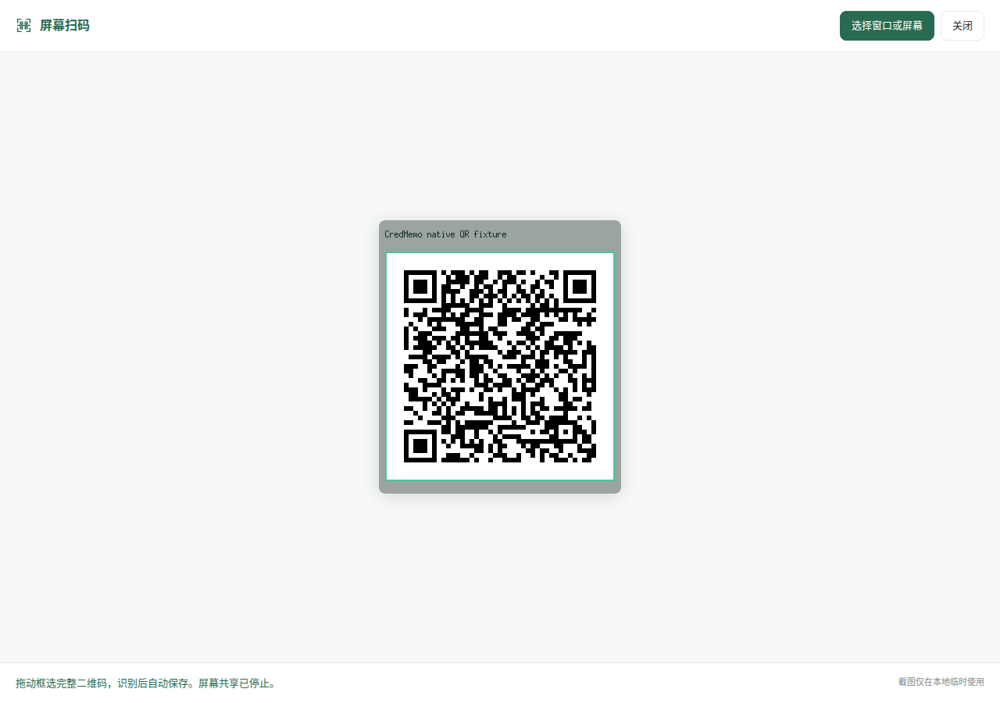

# CredMemo

[](https://github.com/AcidEcho/CredMemo/releases/latest)
[](LICENSE)
[](https://github.com/AcidEcho/CredMemo/actions/workflows/release.yml)

CredMemo 是一个本地加密保存账号、密码和 2FA 动态验证码的 Chrome 扩展。所有凭证保存在当前浏览器中，支持离线使用，无需部署服务端或数据库。

## 功能

- 单独保存账号密码、单独保存 2FA，或将账号与对应 2FA 保存在同一条凭证中。
- 每条凭证支持多个账号和多组 2FA，保存后自动生成动态验证码。
- 手动输入 Base32 密钥或 `otpauth://totp/` 链接，也可以选择二维码图片。
- 点击“扫码”，选择整个屏幕、应用窗口或浏览器标签页，在静态截图上框选二维码，识别后自动保存到“两步验证”。支持浏览器外的应用窗口。
- 一键复制账号、密码和验证码；支持当前网站的账号密码填充。
- 搜索、收藏、中文 / English、浅色 / 深色 / 跟随系统主题。
- 加密备份与恢复、JSON 导入导出、复制导出内容。
- 所有日常管理操作均在工具栏弹窗内完成；屏幕扫码使用独立的临时扫码窗口。

支持 TOTP 的 SHA1、SHA256、SHA512 算法，6 / 8 位验证码及 15 / 30 / 60 秒周期。不支持 HOTP。

## 安装

1. 前往 [Releases](https://github.com/AcidEcho/CredMemo/releases/latest)，下载 `CredMemo-<版本>.zip`。
2. 解压到一个固定目录，确保目录内直接包含 `manifest.json`。
3. 在 Chrome 打开 `chrome://extensions/`，开启右上角“开发者模式”。
4. 点击“加载已解压的扩展程序”，选择该目录，再将 CredMemo 固定到工具栏。
5. 首次打开时创建主密码，长度为 12～256 个字符。本地插件没有默认账号和默认密码。

扩展声明的最低 Chrome 版本为 116。当前自动化浏览器验收使用 Linux Chrome；Windows、macOS 尚未进行真机验收，屏幕捕获还受系统权限及浏览器能力限制。

快捷键：`Alt+Shift+C`。也可以在 `chrome://extensions/shortcuts` 调整。

### 更新

下载新版 ZIP，解压覆盖原来的扩展目录，然后在 `chrome://extensions/` 点击 CredMemo 的“重新加载”。请继续使用原目录，更新前先导出加密备份。新增权限时，按 Chrome 提示确认。

## 使用

### 新建凭证

点击“新建”，选择“账号密码”“两步验证”或“账号密码 + 2FA”，填写标题及对应内容后保存。网站、备注和 2FA 参数等内容在更多选项中配置。

如需网页填充，请在凭证中配置网站地址，并在对应网站打开插件。填充会核对协议、域名和端口；多个表单存在歧义时，先点击目标表单的输入框。插件不会自动提交登录表单。

### 截图扫码

1. 点击标题旁的“扫码”。
2. 在浏览器的来源选择器中，选择包含二维码的应用窗口、屏幕或标签页。
3. 插件获取静态截图后立即停止共享；在截图中拖动框选完整二维码。
4. 识别成功后自动创建仅含 2FA 的凭证，并尝试返回工具栏的“两步验证”列表；若浏览器未自动打开，点击工具栏图标查看。

识别失败时可重新框选，或点击“选择窗口或屏幕”重新截图。截图仅临时保留在本地内存中，关闭扫码窗口、锁定或保存成功后清空。只识别标准 TOTP 二维码；请将二维码完整纳入选框。

也可以在新建 / 编辑凭证时选择本地二维码图片，检查识别结果后保存。

### 备份与恢复

工具栏的备份入口支持：

| 操作 | 行为 |
| --- | --- |
| 加密备份 | 使用独立备份密码，下载 `.credmemo` 文件 |
| 恢复备份 | 选择文件并输入其备份密码，追加导入凭证 |
| 导出 / 复制导出 | 核对主密码后导出 JSON，其中包含明文凭证 |
| 导入 JSON | 导入 CredMemo JSON，校验通过后追加保存 |

导入和恢复采用追加方式，不覆盖原凭证，也不会自动去重。主密码无法找回，请保管好独立密码加密的备份。浏览器配置丢失、卸载扩展或删除扩展数据前，先完成备份。

## 本地存储与权限

凭证通过 AES-256-GCM 加密存入 `chrome.storage.local`，主密码使用 PBKDF2-SHA256 派生密钥，迭代 600,000 次。闲置 15 分钟或重启浏览器后需要重新解锁。数据不会通过 Chrome 同步，也不需要注册或云端账号。

屏幕截图、二维码解码和动态码生成均在本地执行。扩展页面的内容安全策略禁止网络连接。

| 权限 | 用途 |
| --- | --- |
| `storage` | 保存加密凭证和当前浏览器会话 |
| `activeTab`、`scripting` | 用户打开插件后，在当前网站执行填充 |
| `clipboardWrite` | 复制账号、密码、验证码和导出内容 |
| `alarms` | 闲置后自动锁定 |
| `desktopCapture` | 用户选择屏幕、应用窗口或标签页后获取截图 |

## 实际界面

以下截图使用公开测试数据：

| 两步验证 | 应用窗口截图框选 |
| --- | --- |
|  |  |

## 开发

需要 Node.js 24、npm，以及用于生成 ZIP 的 Python 3。

```bash
npm ci
npm run check
npm test
npm run build
npm run package
```

开发时加载 `dist/` 目录；ZIP 输出到 `release/CredMemo-<版本>.zip`。

```text
extension/          插件界面、加密存储、动态码、填充与扫码
scripts/            构建与打包
tests/extension/    核心测试及浏览器验收
assets/screenshots/ 实际界面截图
.github/workflows/  自动验证和 Release 发布
```

核心测试覆盖 RFC 6238 向量、二维码解码、凭证模式、加密存储、锁定、备份、导入校验和并发版本检查。浏览器验收还覆盖真实工具栏弹窗、剪贴板、填充、主题以及跨应用屏幕捕获；相关脚本位于 `tests/extension/`，运行时需额外安装 Playwright 和对应 Chrome，桌面扫码验收还需 Linux X11 / Xvfb。

### 发布规则

本项目每次完成修改后递增版本、提交并推送至 `main`，包括仅修改文档的情况。保持 `package.json`、`package-lock.json` 和扩展 `manifest.json` 的版本一致。

每次推送都会触发 [Release 工作流](.github/workflows/release.yml)：安装依赖 → 类型检查 → 核心测试 → 构建打包 → 发布 `v<版本>` 和 ZIP。已有版本号会导致发布失败，避免覆盖旧版。交付前需确认工作流和 Release 资源实际发布成功。

此规则仅适用于 CredMemo，详见 [AGENTS.md](AGENTS.md)。

## 许可证与分发声明

本项目采用 [Apache License 2.0](LICENSE)。允许使用、修改和商业分发；分发源码或衍生软件时须遵守许可证中的条件，包括：

- 向接收者提供许可证副本。
- 保留适用的版权、专利、商标和署名声明。
- 在修改过的文件中明确注明已作修改。
- 分发衍生软件时，按许可证第 4(d) 条提供 [NOTICE](NOTICE) 中适用署名声明的可读副本。

NOTICE 包含项目名称、作者与项目地址，发布 ZIP 同时携带 LICENSE、NOTICE 和适用的第三方许可证。以上为简要说明，具体权利与义务以 LICENSE 正文为准。

二维码识别使用 [jsQR](https://github.com/cozmo/jsQR)，同样采用 Apache-2.0，其许可证位于 [extension/public/licenses/jsqr.txt](extension/public/licenses/jsqr.txt)。

构建输出包含 Vite 生成的模块预加载辅助代码，其 MIT 许可证位于 [extension/public/licenses/vite.txt](extension/public/licenses/vite.txt)。
